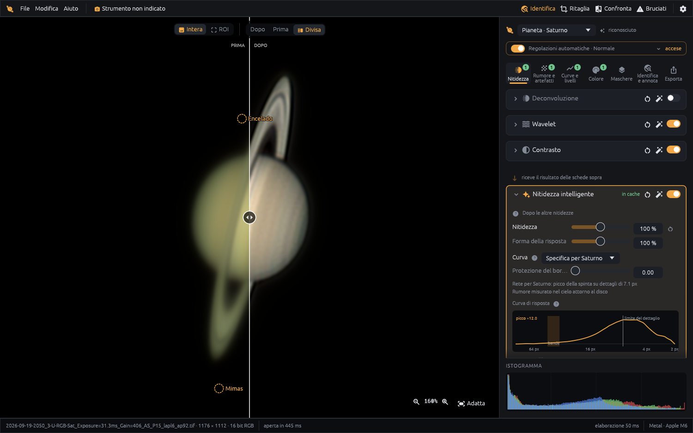
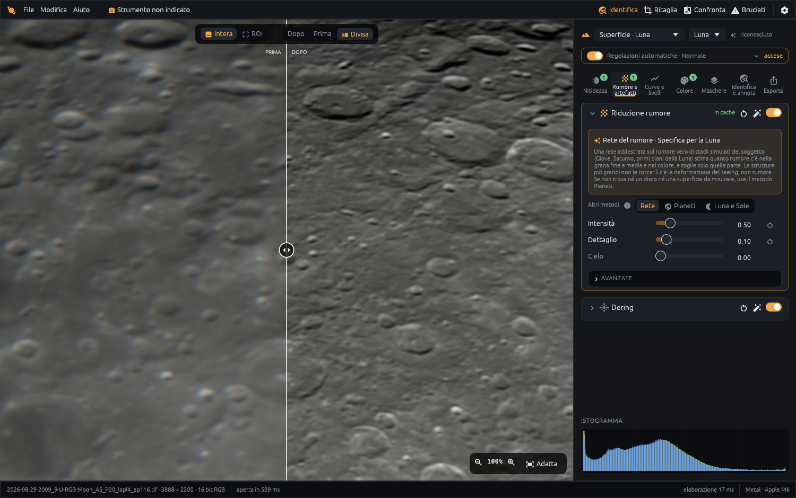
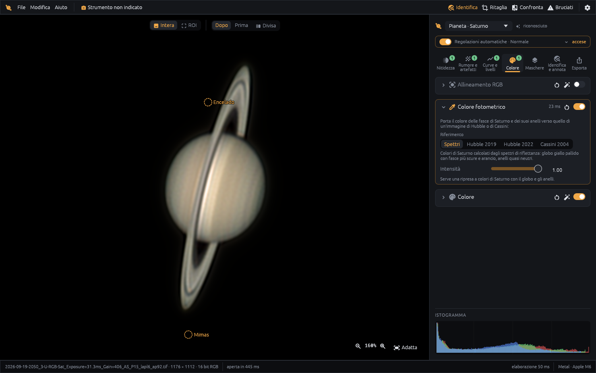
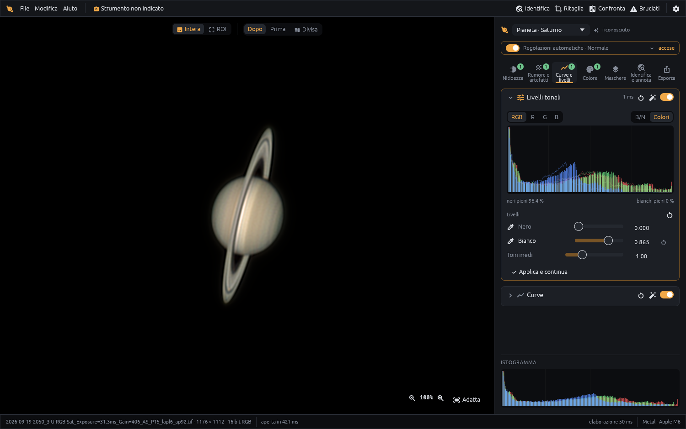
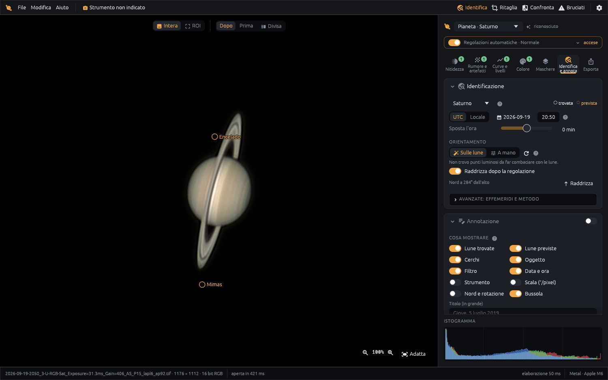
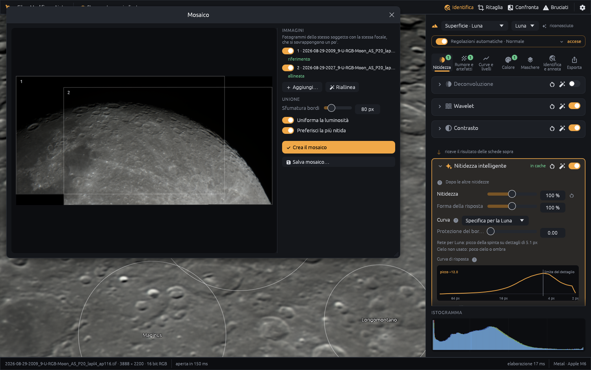

# Planetary Studio

### Software gratuito per elaborare immagini planetarie e lunari: wavelet, deconvoluzione, maschere a livelli, nitidezza e riduzione del rumore con reti neurali. Per macOS, Windows e Linux.

**Planetary Studio è un programma di elaborazione per immagini astronomiche di Giove, Saturno, Marte, Luna e Sole già impilate con AutoStakkert!, RegiStax o simili. Riunisce in una sola finestra wavelet, deconvoluzione, livelli e curve, colore fotometrico e maschere a livelli come in Photoshop, e aggiunge due cursori nuovi: la nitidezza intelligente e il rumore intelligente, addestrati su riprese simulate. Gira su macOS, Windows e Linux, in italiano e in inglese. Gratuito per uso non commerciale.**

🇬🇧 [Read in English](README.md) · [Scarica](#scarica) · [Che cosa fa](#che-cosa-fa)


*Saturno, 19 settembre 2026, aperto e preelaborato con un clic. Tutte le immagini di questa pagina sono riprese dell'autore.*

---

## Perché Planetary Studio

Gli strumenti per l'elaborazione planetaria sono pochi, quasi tutti solo per Windows e con un'interfaccia ferma da anni. Planetary Studio nasce per la fase che segue lo stacking e prova a fare quel lavoro in modo più semplice, restando preciso.

- **Un solo programma per tutti i sistemi.** macOS (Apple Silicon e Intel), Windows 10/11 e Linux, con lo stesso aspetto e le stesse funzioni.
- **Nitidezza intelligente: un cursore al posto di molti.** Una rete addestrata per ogni soggetto decide quanto rafforzare ogni dimensione di dettaglio. Sostituisce la regolazione a mano dei livelli wavelet, ma i pixel li calcolano sempre le wavelet: non viene aggiunto dettaglio che non c'era.
- **Rumore intelligente.** Una seconda rete, addestrata su stack simulati, toglie la grana fine e media e lascia intatte le strutture. Su immagini mai viste il suo errore è circa la metà di quello dei metodi classici.
- **Livelli e maschere come in Photoshop.** Anelli di Saturno, globo, lune o una zona dipinta a mano hanno ciascuno le proprie regolazioni e si fondono con le modalità Moltiplica, Scherma, Luce soffusa e le altre.
- **Riconosce e annota.** Capisce se l'immagine è Saturno, Giove, Marte, la Luna o il Sole; trova e nomina le lune di Giove e Saturno, mette in alto il nord e scrive una didascalia sull'immagine.
- **Colore fotometrico.** Fasce, zone e anelli vengono portati a spettri di riflettanza misurati, non al gusto del momento.
- **Non distruttivo.** Ogni passo è una scheda con interruttore e cursore, annullabile, con confronto prima/dopo.

## Che cosa fa

### Prima e dopo, con un clic



Alla prima apertura l'app chiede se vuoi l'immagine com'è o già preelaborata, e ricorda la scelta. La preelaborazione applica nitidezza adatta al soggetto, riduzione del rumore, colore, livelli e raddrizzamento, tutto modificabile dopo. La vista divisa mette a confronto l'uscita dello stacker e il risultato; la barra spaziatrice passa da uno all'altro.

### Nitidezza intelligente

Nell'immagine in alto è aperta la scheda **Nitidezza intelligente**. Mostra la curva di risposta: quanto viene rafforzato ogni dettaglio, dai 64 ai 2 pixel, e dove finisce il dettaglio reale dell'immagine. Si può modellare a mano o lasciare alla rete, e l'app spiega la sua scelta (le fasce misurate, il limite di risoluzione, che cosa ha pesato). Esistono reti separate per Giove, Saturno, Marte e Luna, addestrate su stack di lucky imaging simulati fotogramma per fotogramma.

### Rumore intelligente



La rete del rumore stima quanto ce n'è nella grana fine e media e nel colore, e toglie solo quella parte. Le strutture più grandi non vengono toccate. Tre cursori: intensità, dettaglio e cielo. Gira sul processore, senza scaricare nulla. I metodi classici per pianeti, Luna e Sole restano disponibili.

### Maschere a livelli


Le maschere funzionano come livelli di regolazione. La maschera degli anelli qui sopra l'ha creata l'app con un clic; si può fare lo stesso per il globo e per le lune, oppure dipingere una zona con il pennello. Dentro ogni maschera si inseriscono wavelet, rumore, contrasto o colore, con opacità e modalità di fusione.

### Colore fotometrico



La scheda **Colore fotometrico** porta il colore di fasce e anelli verso un riferimento fisico: spettri di albedo misurati su tutto il disco di Saturno e Giove (Karkoschka 1998, Mallama et al. 2017) oppure le mappe di Hubble e Cassini. Anche Marte ha il suo riferimento. L'intensità è un cursore.

### Livelli e curve



Livelli e curve per canale, con istogramma, contagocce per nero e bianco e correzione dei toni medi. La preelaborazione imposta nero e bianco vicino agli estremi senza mai tagliare le luci.

### Identificazione e annotazione



Dall'ora della ripresa l'app calcola dove si trovano le lune di Giove e Saturno, le cerca nell'immagine e le nomina; per la Luna indica i mari. Poi stima l'orientamento e porta il nord in alto. Nome, luogo e strumento (impostati una volta) compilano la didascalia, che si stampa sull'immagine esportata con data, filtro, scala e bussola.

### Dettaglio lunare


La Luna ha reti proprie per la nitidezza e per il rumore: bordi e raggi diventano netti, il cielo resta pulito. Il particolare qui sopra viene da una ripresa a 3888 × 2200 pixel.

### Mosaici di Luna e Sole



Apri insieme più pannelli sovrapposti: vengono allineati, portati alla stessa luminosità e fusi lungo le giunzioni, preferendo il pannello più nitido dove si sovrappongono.

## Tutte le funzioni

**Elaborazione**
- **Nitidezza intelligente** per Giove, Saturno, Marte e Luna, con curva di risposta visibile e modificabile.
- **Rumore intelligente** (U-Net addestrata su stack simulati con rumore di fotoni, grana correlata e piedistallo del cielo).
- **Deconvoluzione** Richardson–Lucy e Wiener, con PSF misurata sull'immagine o da una stella e protezione dagli aloni.
- **Wavelet** (starlet con scale libere), **contrasto**, **livelli e curve** per canale.
- **Pennello anti-alone**: si dipinge sopra un anello scuro e viene misurato e sollevato.
- **Allineamento RGB** quando si misura la dispersione atmosferica, applicato solo se i bordi dei tre canali coincidono meglio.
- **Colore fotometrico** per Giove, Saturno e Marte; falsi colori per il Sole.
- **Maschere a livelli** con modalità di fusione, maschere automatiche per anelli, globo e lune.
- **Preelaborazione automatica** all'apertura, a scelta.

**Più riprese insieme**
- **Derotazione di Giove e Saturno**: più riprese vengono portate allo stesso istante in base alla rotazione del pianeta e sommate. Una finestra mostra il globo, modificabile, con le ore, il risultato e la mappa cilindrica del pianeta.
- **Mono → RGB e LRGB**, in modo classico o derotato.
- **Animazione**: GIF e MP4 fluidi da poche riprese, con interpolazione fra i fotogrammi.
- **Mosaici** di Luna e Sole.
- **Elabora una serie**: un'intera cartella in secondo piano, con avanzamento e pulsante Interrompi.

**Conosce il cielo**
- **Riconoscimento del soggetto** dal nome del file, dal log di ripresa o dai pixel. Se sbaglia, si sceglie quello giusto e le impostazioni lo seguono.
- **Lune di Giove e Saturno**, mari lunari, orientamento e nord, dall'ora della ripresa.
- **Log di ripresa** di FireCapture, SharpCap e AutoStakkert! letti per soggetto, ora, filtro e strumento.

**Flusso di lavoro**
- **Configurazioni dello strumento**: telescopio, camera, Barlow e filtro salvati con un nome, con un preferito per le nuove immagini.
- **Confronti**: prima/dopo, vista divisa, anteprima su una regione (ROI).
- **Formati**: apre TIFF, FITS, PNG e JPEG; esporta TIFF e PNG a 16 bit e JPEG a 8 bit, con ridimensionamento.
- **Accelerazione GPU** (Metal, DirectX 12, Vulkan) con ritorno automatico al processore.
- Ponte facoltativo con **BlurXTerminator** (versione a riga di comando).
- Interfaccia in italiano e inglese.

> Lo stacking in sé è fuori dallo scopo: Planetary Studio apre immagini già impilate (AutoStakkert!, RegiStax e simili).

## Scarica

Prendi l'ultima versione dalla **[pagina delle Release](../../releases/latest)**:

| Sistema | File | Note |
|---|---|---|
| macOS, Apple Silicon (M1 e successivi) | `PlanetaryStudio-1.0.0-macos-apple-silicon.dmg` | Apri il DMG e trascina *Planetary Studio* in *Applicazioni*. |
| macOS, Intel | `PlanetaryStudio-1.0.0-macos-intel.dmg` | Uguale. |
| macOS, entrambi in uno | `PlanetaryStudio-1.0.0-macos-universal.dmg` | Gira in modo nativo su entrambi; pesa circa il doppio. |
| Windows 10/11 (64 bit) | `PlanetaryStudio-1.0.0-windows-x64.zip` | Portatile: decomprimi e avvia, nessuna installazione. |
| Linux (x86_64) | `PlanetaryStudio-1.0.0-linux-x86_64.AppImage` | Rendilo eseguibile con `chmod +x` e avvialo. C'è anche un `.tar.gz` con il solo eseguibile. Serve un driver grafico con Vulkan (Mesa va bene). |

**Primo avvio.** L'app non è firmata con un certificato Apple o Microsoft a pagamento, quindi il sistema avvisa la prima volta:

- **macOS**: clic destro sull'app → *Apri* → *Apri*. Sulle versioni recenti: *Impostazioni di Sistema → Privacy e sicurezza → Apri comunque*.
- **Windows**: nella finestra SmartScreen clicca *Ulteriori informazioni* → *Esegui comunque*.

## Domande frequenti

**Sostituisce RegiStax?** Sostituisce la parte di RegiStax che viene dopo lo stacking (wavelet, deconvoluzione, colore, rifinitura). Non impila i fotogrammi: per quello restano AutoStakkert!, RegiStax o simili.

**Inventa dettagli?** No. Le reti decidono solo quanto rafforzare ogni scala di dettaglio e quanto rumore togliere; i pixel li calcolano le wavelet e la riduzione del rumore sul tuo segnale.

**Su quali soggetti funziona?** Giove, Saturno, Marte, Luna e Sole. Per Giove, Saturno, Marte e Luna ci sono reti dedicate.

**Serve una scheda grafica?** No. Se c'è, l'app usa la GPU (Metal, DirectX 12, Vulkan); altrimenti lavora sul processore.

**È gratuito?** Sì, per qualsiasi uso non commerciale.

## Compilare dai sorgenti

Serve [Rust](https://rustup.rs) (stable).

```bash
cargo run --release -p ps-app
```

Pacchetti (il workflow `.github/workflows/release.yml` li costruisce tutti quando si pusha un tag `vX.Y.Z`):

```bash
packaging/make_dmg.sh --apple-silicon   # DMG per macOS (anche --intel, --universal)
packaging/make_windows.sh               # zip per Windows (nativo su Windows, cross-build con MinGW altrove)
packaging/make_linux.sh                 # AppImage + tar.gz per Linux (da Linux)
```

## Licenza

Copyright © 2026 Weryc. Il codice di Planetary Studio è **consultabile** e distribuito con la **[PolyForm Noncommercial License 1.0.0](LICENSE.md)**.

In breve (fa fede il testo della licenza, in inglese):

- ✅ Gratis **per qualsiasi scopo non commerciale**: hobby, studio, ricerca, scuole, associazioni, enti non profit.
- ✅ Puoi leggere il codice e modificarlo per scopi non commerciali, e condividerlo senza scopo di lucro mantenendo la licenza e la riga `Required Notice`.
- ❌ **Non puoi venderlo** né usarlo per scopi commerciali.
- © Il diritto d'autore e la proprietà intellettuale restano dell'autore.

Per un uso commerciale, o per qualsiasi uso non coperto dalla licenza, [apri una issue](../../issues) per chiedere il permesso.

Le librerie di terze parti mantengono le proprie licenze: vedi [THIRD_PARTY.md](THIRD_PARTY.md).
