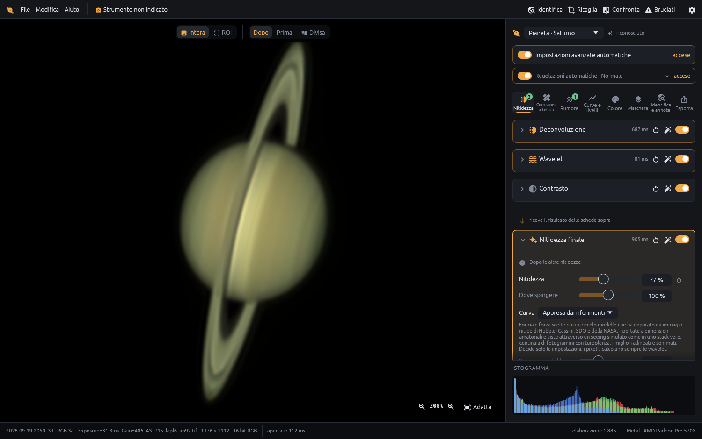
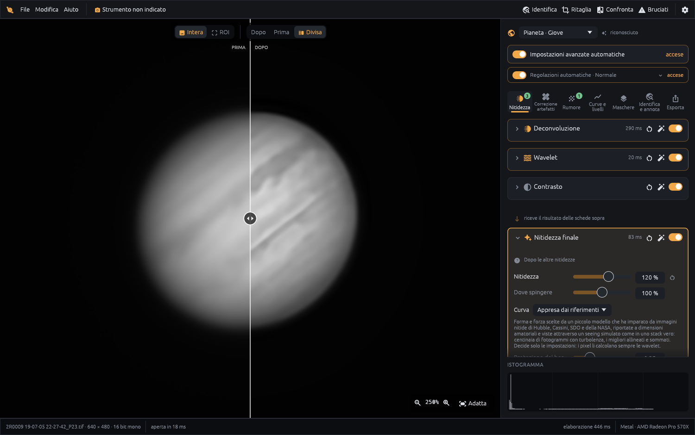
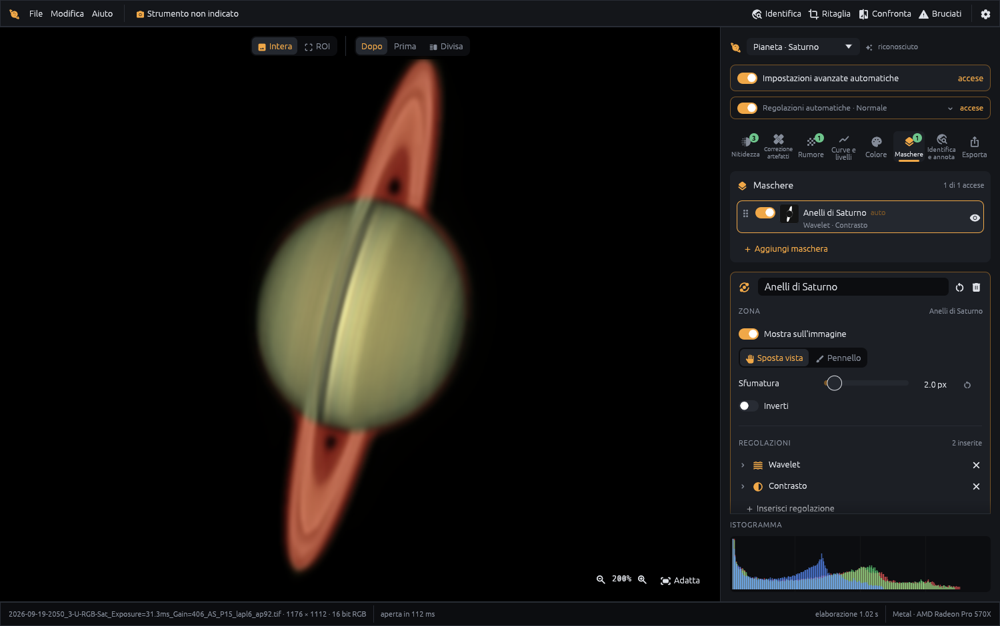
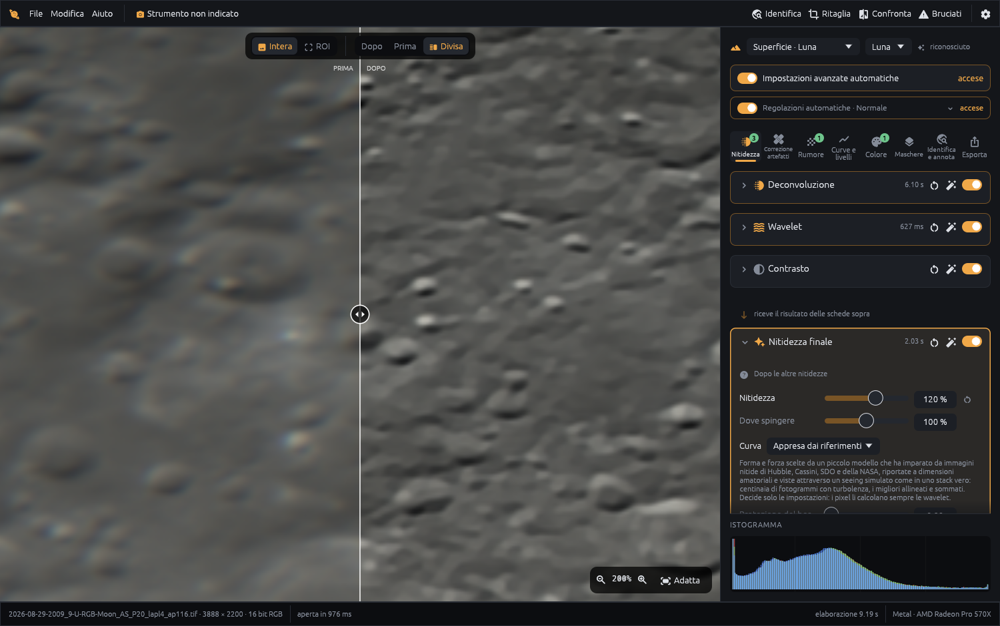
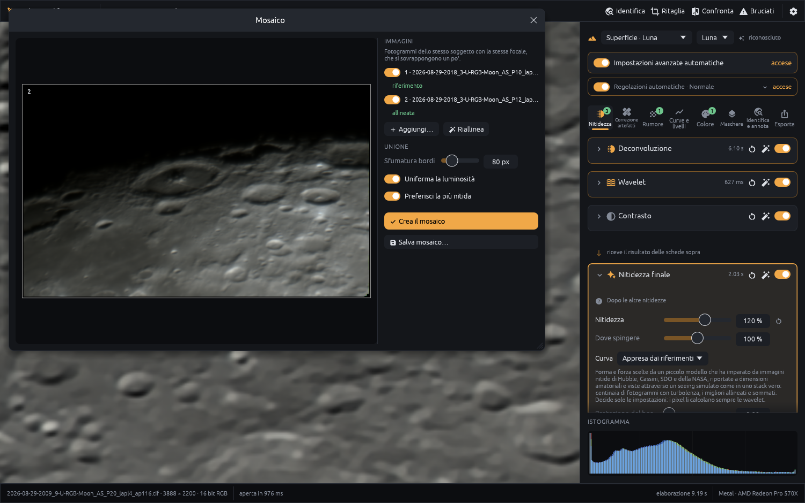
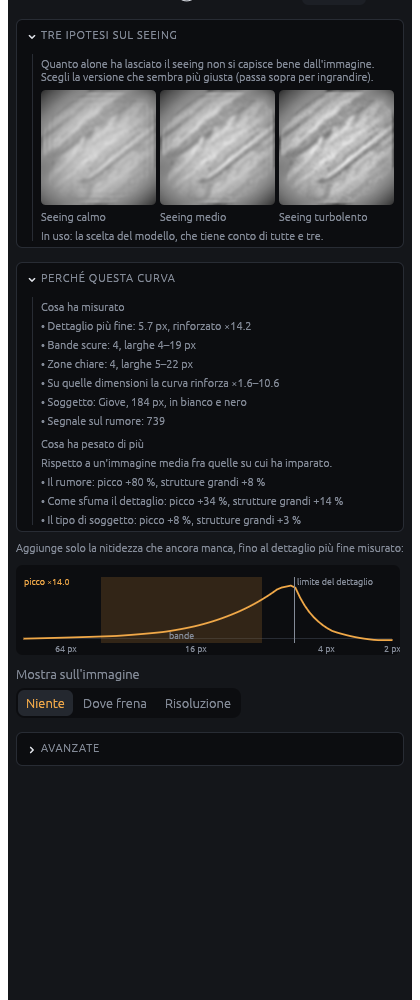

# Planetary Studio — elaborazione e nitidezza planetaria per Mac, Windows e Linux

**Elaborazione veloce e non distruttiva di immagini planetarie e lunari già stackate: nitidezza planetaria appresa, wavelet, deconvoluzione, riduzione del rumore e mosaici lunari — un'alternativa gratuita a RegiStax e AstroSurface per macOS, Windows e Linux, in italiano e inglese.**

🇬🇧 [Read in English](README.md)



Planetary Studio parte da dove finisce il tuo programma di stacking (AutoStakkert!, RegiStax, …): rende nitido, ripulisce e rifinisce il TIFF stackato di Giove, Saturno, Marte o della Luna — l'astrofotografia planetaria dopo il lucky imaging. Riconosce cosa hai aperto, propone impostazioni sensate e spiega perché, lasciando sempre a te ogni cursore.

> Lucky imaging e stacking sono fuori dallo scopo: apri un'immagine già stackata.

## Download

Scarica l'ultima versione dalla **[pagina delle Release](../../releases/latest)**:

| Sistema | File | Note |
|---|---|---|
| macOS (Intel e Apple Silicon) | `PlanetaryStudio-<versione>-universal.dmg` | Apri il DMG e trascina *Planetary Studio* in *Applicazioni*. |
| Windows 10/11 (64 bit) | `PlanetaryStudio-<versione>-windows-x64.exe` | Portatile: niente installazione, basta avviarlo. |
| Linux (x86_64) | `PlanetaryStudio-<versione>-linux-x86_64.AppImage` | Rendilo eseguibile (`chmod +x`) e avvialo. C'è anche un `.tar.gz` con il solo programma. Serve un driver grafico con Vulkan (va bene Mesa). |

**Primo avvio.** L'app non è firmata con un certificato Apple/Microsoft a pagamento, quindi la prima volta il sistema mostra un avviso:

- **macOS** — clic destro sull'app → *Apri* → *Apri*. Sulle versioni recenti: *Impostazioni di Sistema → Privacy e sicurezza → Apri comunque*.
- **Windows** — nella finestra di SmartScreen fai clic su *Ulteriori informazioni* → *Esegui comunque*.

## Funzioni

- **Riconoscimento automatico** del soggetto (pianeta, Saturno, disco intero, superficie lunare), con impostazioni strutturali e la spiegazione di ogni scelta automatica.
- **Deconvoluzione** — Richardson–Lucy (accelerata, con regolarizzazione TV e smorzamento) e Wiener; PSF misurata dall'immagine, disegnando un riquadro o cliccando una stella; anti-ringing integrato.
- **Wavelet** — starlet isotropa (*à trous*) con scale libere posizionate in base allo spettro dell'immagine, oppure scale classiche 1-2-4-8; guadagni adattivi al rumore e protezione dei bordi.
- **Nitidezza finale appresa** — un piccolo modello sceglie quanto rinforzare ogni dimensione di dettaglio, dalle bande di Giove fino al dettaglio più fine lasciato dal seeing; i pixel li calcolano sempre le wavelet classiche, niente viene inventato. È stato addestrato su immagini nitide di Hubble, Cassini, SDO e NASA viste attraverso un seeing simulato come in uno stack vero (centinaia di fotogrammi con turbolenza, i migliori allineati e sommati). Quando dall'immagine non si capisce quanto era turbolenta la serata, mostra il risultato con seeing calmo, medio e turbolento uno accanto all'altro, e spiega la sua scelta: le bande misurate, dove finisce il dettaglio, cosa ha pesato di più.
- **Riduzione del rumore** per tipo di soggetto, **dering** a pennello: dipingi sopra l'anello scuro (dentro il bordo, nel cielo attorno, accanto a un cratere) e viene misurato e schiarito fino a ciò che ha accanto, senza toccare bordi e bande, **curve e livelli** (anche per canale), **colore**, allineamento RGB, Mineral Moon.
- **Maschere** — elabora a parte gli anelli di Saturno, il globo, le lune o una zona dipinta. Un elenco chiaro mostra di ogni maschera la miniatura, cosa cambia e l'ordine (si riordina trascinando).
- **Confronto A/B**, vista prima/dopo divisa, anteprima su ROI.
- **Strumentazione e diagnosi** — catalogo telescopi/camere, lettura dei log di FireCapture/SharpCap/AutoStakkert!, scala dell'immagine dalle effemeridi, grafico dello spettro.
- **Identifica e annota** — nomi delle lune di Giove e Saturno, crateri e mari lunari, orientamento del Sole, dall'ora della ripresa; esportazione con i nomi sull'immagine.
- **Colore** — il colore di Giove riportato a quello delle mappe NASA banda per banda (colore fotometrico), palette in falsi colori per il Sole in H-alfa.
- **Ridimensionamento all'esportazione** con kernel classici (Lanczos, Mitchell) scelti per soggetto.
- **Interfaccia in italiano e inglese** (si cambia nelle Impostazioni).
- **Mosaici** di riprese lunari fatte con la stessa focale.
- **Formati**: TIFF 8/16/32 bit, FITS, PNG, JPEG.
- **Accelerazione GPU** (Metal, DirectX 12, Vulkan tramite wgpu) con ripiego automatico sulla CPU.
- Collegamento facoltativo a **BlurXTerminator**, se possiedi una licenza della sua versione a riga di comando.

## Galleria

Tutte le immagini sono riprese dell'autore, elaborate nell'app.

| | |
|---|---|
|  |  |
| **Giove** — prima/dopo, vista divisa | **Saturno** — anelli con una maschera propria |
|  |  |
| **Luna** — dettaglio dei crateri, prima/dopo | **Mosaico lunare** — riprese allineate e fuse |

### La nitidezza appresa, spiegata



La scheda Nitidezza finale con la curva appresa su Giove:

- **Tre ipotesi sul seeing** — il soggetto con seeing calmo, medio e turbolento; un clic sceglie quella che sembra giusta.
- **Perché questa curva** — cosa ha misurato (dettaglio più fine, bande scure e zone chiare con la loro larghezza, soggetto, segnale sul rumore) e cosa ha spinto la curva in su o in giù.
- **Il grafico della risposta** — quanto viene rinforzata ogni dimensione di dettaglio, con la fascia delle bande del pianeta.

Il modello sceglie solo le impostazioni; la nitidezza vera e propria è matematica e riproducibile.

<br clear="right">

## Compilare dai sorgenti

Serve [Rust](https://rustup.rs) (stable).

```bash
cargo run --release -p ps-app
```

Pacchetti:

```bash
packaging/make_dmg.sh --universal   # DMG per macOS, Intel + Apple Silicon
packaging/make_windows.sh           # .exe per Windows, cross-compilato da macOS (serve mingw-w64)
packaging/make_linux.sh             # AppImage + tar.gz per Linux (da Linux; per le release lo fa GitHub Actions)
```

Il progetto tecnico (algoritmi, pipeline, roadmap, bibliografia) è in [docs/ARCHITETTURA.md](docs/ARCHITETTURA.md).

## Licenza

Copyright © 2026 Weryc. Il codice di Planetary Studio è **consultabile** e distribuito con la **[PolyForm Noncommercial License 1.0.0](LICENSE.md)**.

In breve (fa fede il testo della licenza, in inglese):

- ✅ Puoi usarlo **gratis per qualsiasi scopo non commerciale** — hobby, studio, ricerca, scuole, associazioni, enti non profit.
- ✅ Puoi leggere il codice e modificarlo per scopi non commerciali, e condividerlo senza scopo di lucro mantenendo la licenza e la riga `Required Notice`.
- ❌ **Non puoi venderlo** né usarlo per scopi commerciali.
- © Il diritto d'autore e la proprietà intellettuale restano dell'autore.

Per un uso commerciale, o per qualsiasi uso non coperto dalla licenza, [apri una issue](../../issues) per chiedere il permesso.

Le librerie di terze parti mantengono le proprie licenze: vedi [THIRD_PARTY.md](THIRD_PARTY.md).
