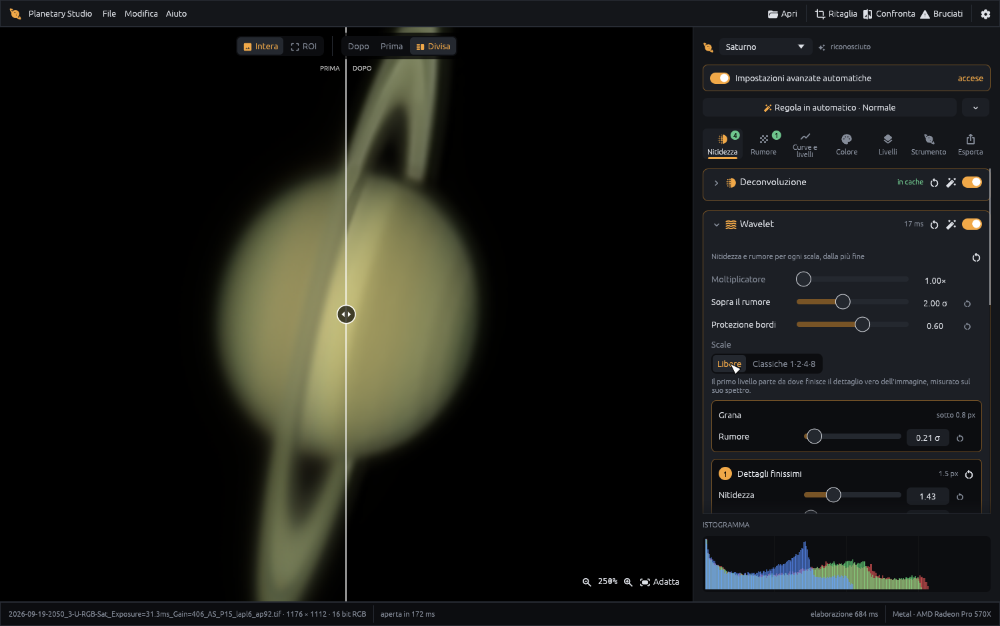

# Planetary Studio — planetary image processing and sharpening for Mac, Windows and Linux

**Fast, non-destructive processing of stacked planetary and lunar images: wavelet sharpening, deconvolution, noise reduction and lunar mosaics — a free alternative to RegiStax and AstroSurface for macOS, Windows and Linux.**

🇮🇹 [Leggi in italiano](README.it.md)


Planetary Studio picks up where your stacker (AutoStakkert!, RegiStax, …) leaves off: it sharpens, cleans and finishes the stacked TIFF of Jupiter, Saturn, Mars or the Moon — the astrophotography workflow after lucky imaging. It recognises what you opened, proposes sensible settings and explains why — while every slider stays in your hands.

> Lucky imaging and stacking are out of scope: open an image that is already stacked.

## Download

Get the latest version from the **[Releases page](../../releases/latest)**:

| System | File | Notes |
|---|---|---|
| macOS (Intel and Apple Silicon) | `PlanetaryStudio-<version>-universal.dmg` | Open the DMG and drag *Planetary Studio* to *Applications*. |
| Windows 10/11 (64-bit) | `PlanetaryStudio-<version>-windows-x64.exe` | Portable: no installation, just run it. |
| Linux (x86_64) | `PlanetaryStudio-<version>-linux-x86_64.AppImage` | `chmod +x` it and run it. A `.tar.gz` with the bare binary is there too. Needs a Vulkan-capable graphics driver (Mesa is fine). |

**First launch.** The app is not signed with a paid Apple/Microsoft certificate, so the system warns you the first time:

- **macOS** — right-click the app → *Open* → *Open*. On recent macOS versions: *System Settings → Privacy & Security → Open Anyway*.
- **Windows** — on the SmartScreen dialog click *More info* → *Run anyway*.

## Features

- **Automatic recognition** of the subject (planet, Saturn, full disk, lunar surface) with structural settings and explanations of every automatic choice.
- **Deconvolution** — Richardson–Lucy (accelerated, with TV regularisation and damping) and Wiener; PSF measured from the image, drawn on a box, or picked from a star; built-in anti-ringing.
- **Wavelets** — isotropic starlet (*à trous*) with free scales placed from the image spectrum, or classic 1-2-4-8 scales; noise-adaptive gains and edge protection.
- **Final sharpening** — works on the result of every other sharpening step and boosts exactly the scales where real detail is, stopping at the detail limit measured on the image's spectrum.
- **Noise reduction** tuned per subject, **dering** with a brush: paint over the dark ring (inside the limb, in the sky around it, beside a crater) and it is measured and lifted to its surroundings, edges and belts untouched, **curves and levels** (per channel), **colour**, RGB alignment, Mineral Moon.
- **Masks** — process Saturn's rings, its globe, the moons or a painted zone with their own settings. A clear list shows each mask's thumbnail, what it changes and its order (drag to reorder).
- **A/B compare**, split before/after view, ROI preview.
- **Equipment & diagnostics** — telescope/camera catalogue, FireCapture/SharpCap/AutoStakkert! log reading, image scale from ephemerides, spectrum graph.
- **Mosaics** of lunar panels taken with the same focal length.
- **Formats**: TIFF 8/16/32-bit, FITS, PNG, JPEG.
- **GPU acceleration** (Metal, DirectX 12, Vulkan through wgpu) with automatic CPU fallback.
- Optional bridge to **BlurXTerminator** if you own a licence of its command-line version.

## Gallery

| | |
|---|---|
|  |  |
| **Jupiter** — before/after split view | **Saturn** — rings sharpened with their own mask |
|  |  |
| **Moon** — crater detail, before/after | **Lunar mosaic** — panels aligned and blended |



The interface is currently in Italian.

## Building from source

You need [Rust](https://rustup.rs) (stable).

```bash
cargo run --release -p ps-app
```

Packages:

```bash
packaging/make_dmg.sh --universal   # macOS DMG, Intel + Apple Silicon
packaging/make_windows.sh           # Windows .exe, cross-compiled from macOS (needs mingw-w64)
packaging/make_linux.sh             # Linux AppImage + tar.gz (run on Linux; GitHub Actions does it for releases)
```

The technical design (algorithms, pipeline, roadmap, bibliography) is in [docs/ARCHITETTURA.md](docs/ARCHITETTURA.md) (Italian).

## License

Copyright © 2026 Weryc. Planetary Studio is **source-available**, released under the **[PolyForm Noncommercial License 1.0.0](LICENSE.md)**.

In short (the license text is what counts):

- ✅ You may use it **for free for any noncommercial purpose** — hobby, study, research, schools, clubs, non-profits.
- ✅ You may read the code and change it for noncommercial purposes, and share it noncommercially as long as you keep the license and the `Required Notice` line.
- ❌ You may **not sell it** or use it for any commercial purpose.
- © Copyright and intellectual property remain with the author.

For commercial use, or any use the license does not cover, please [open an issue](../../issues) to ask for permission.

Third-party libraries keep their own licenses: see [THIRD_PARTY.md](THIRD_PARTY.md).
