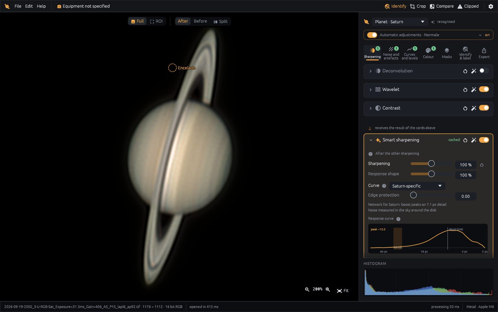
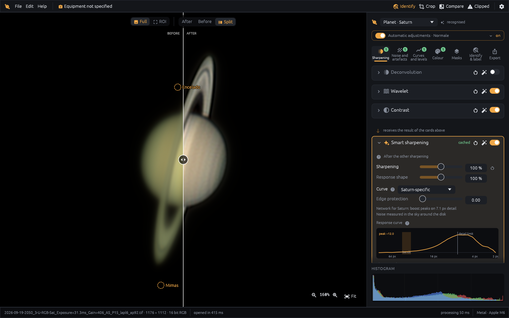
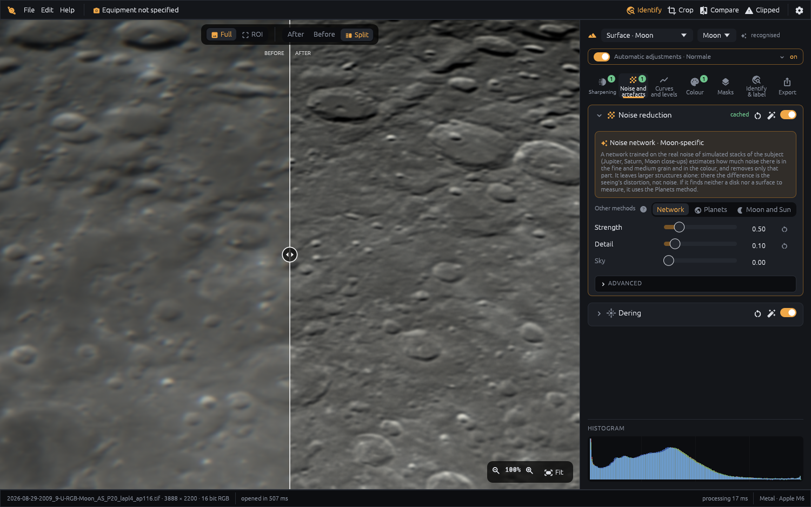
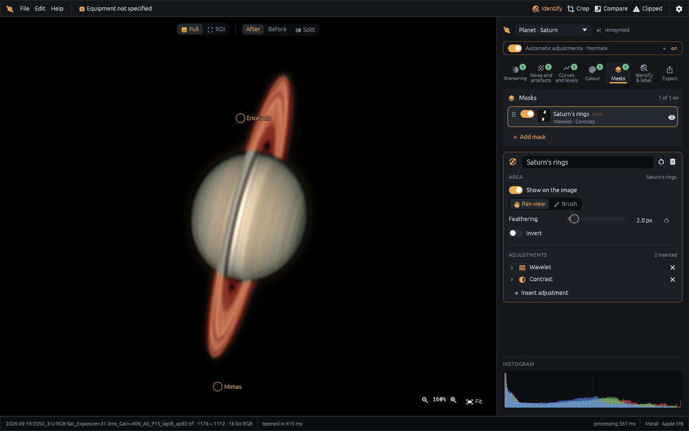
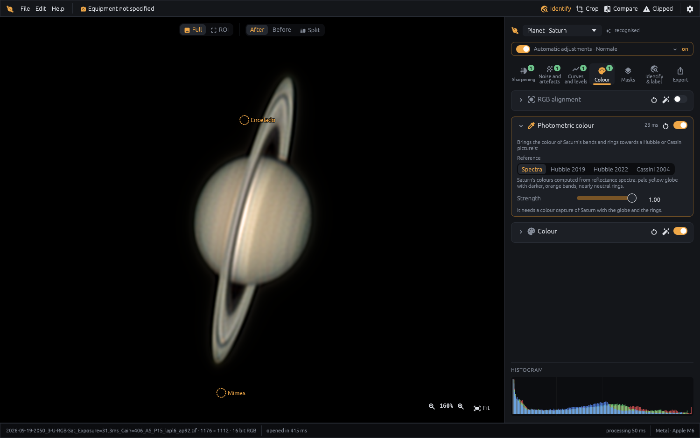
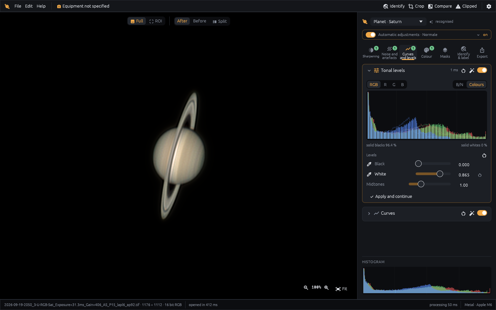
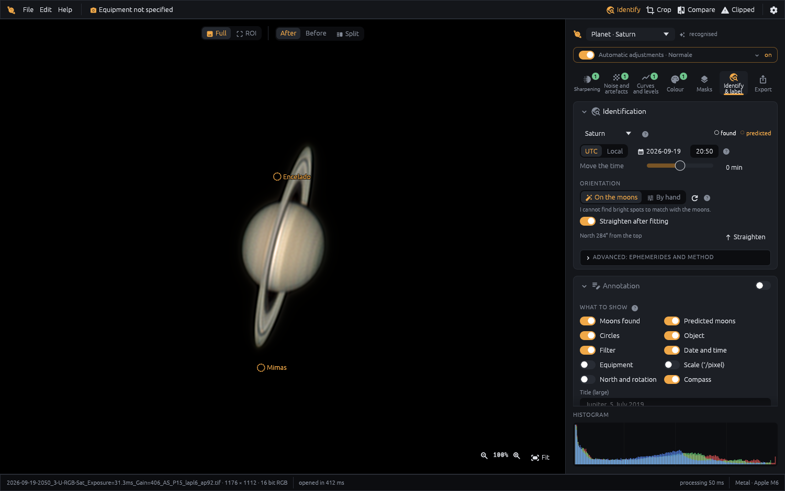
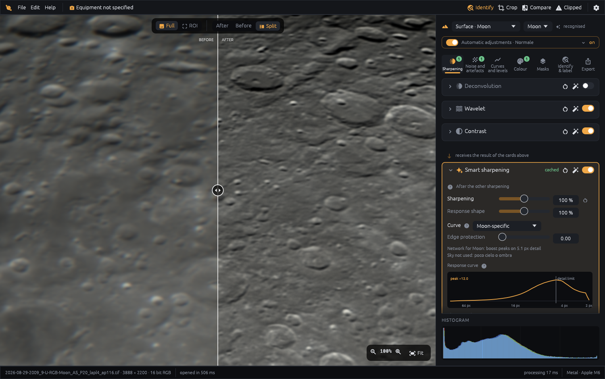
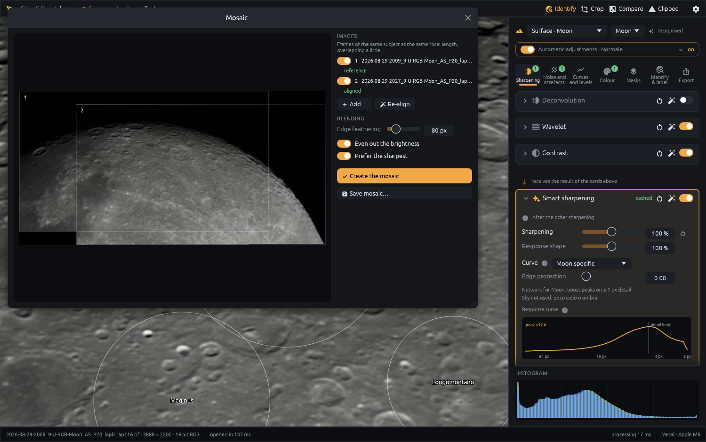

# Planetary Studio

### Free planetary and lunar image processing: wavelets, deconvolution, layer masks, and neural-network sharpening and denoising. For macOS, Windows and Linux.

**Planetary Studio is a processing program for astronomy images of Jupiter, Saturn, Mars, the Moon and the Sun that have already been stacked with AutoStakkert!, RegiStax or similar. It puts wavelets, deconvolution, levels and curves, photometric colour and Photoshop-style layer masks in one window, and adds two new sliders: smart sharpening and smart noise reduction, trained on simulated captures. It runs on macOS, Windows and Linux, in English and Italian. Free for noncommercial use.**

🇮🇹 [Leggi in italiano](README.it.md) · [Download](#download) · [What it does](#what-it-does)



*Saturn, 19 September 2026, opened and pre-processed in one click. Every picture on this page is the author's own capture.*

---

## Why Planetary Studio

Planetary processing tools are few, most of them Windows-only, with interfaces that have not changed in years. Planetary Studio covers the step after stacking and tries to make that work simpler while staying accurate.

- **One program on every system.** macOS (Apple Silicon and Intel), Windows 10/11 and Linux, with the same look and the same features.
- **Smart sharpening: one slider instead of many.** A network trained for each subject decides how much to strengthen each scale of detail. It replaces setting the wavelet layers by hand, but the pixels are still computed by wavelets: no detail is added that was not in the image.
- **Smart noise reduction.** A second network, trained on simulated stacks, removes fine and medium grain and leaves structures alone. On images it has never seen, its error is about half that of the classic methods.
- **Layers and masks as in Photoshop.** Saturn's rings, the globe, the moons or a zone you paint each get their own adjustments and blend with Multiply, Dodge, Soft Light and the other modes.
- **Recognises and annotates.** It tells whether the image is Saturn, Jupiter, Mars, the Moon or the Sun, finds and names the moons of Jupiter and Saturn, puts north up and writes a caption on the image.
- **Photometric colour.** Bands, zones and rings are brought to measured reflectance spectra, not to taste.
- **Non-destructive.** Every step is a card with a switch and a slider, undoable, with before/after comparison.

## What it does

### Before and after, in one click



On first opening, the app asks whether you want the image as it is or already pre-processed, and remembers the answer. Pre-processing applies sharpening suited to the subject, noise reduction, colour, levels and straightening, all editable afterwards. The split view compares the stacker's output with the result; the space bar flips between them.

### Smart sharpening

The **Smart sharpening** card is open in the picture at the top. It shows the response curve: how much each scale of detail is strengthened, from 64 down to 2 pixels, and where the real detail of the image ends. You can shape it by hand or leave it to the network, and the app explains its choice (the bands measured, the resolution limit, what weighed most). There are separate networks for Jupiter, Saturn, Mars and the Moon, trained on lucky-imaging stacks simulated frame by frame.

### Smart noise reduction



The noise network estimates how much noise there is in the fine and medium grain and in the colour, and removes only that part. Larger structures are not touched. Three sliders: strength, detail and sky. It runs on the processor and downloads nothing. The classic methods for planets, Moon and Sun are still available.

### Layer masks



Masks work like adjustment layers. The rings mask above was made by the app in one click; the same can be done for the globe and the moons, or you can paint a zone with the brush. Inside each mask you insert wavelets, noise reduction, contrast or colour, with opacity and blend mode.

### Photometric colour



The **Photometric colour** card moves the colour of bands and rings toward a physical reference: albedo spectra measured over the whole disc of Saturn and Jupiter (Karkoschka 1998, Mallama et al. 2017), or the Hubble and Cassini maps. Mars has its own reference. The strength is a slider.

### Levels and curves



Levels and curves per channel, with a histogram, eyedroppers for black and white, and a midtone control. Pre-processing sets black and white close to the ends without ever clipping highlights.

### Identification and annotation



From the capture time the app computes where the moons of Jupiter and Saturn are, looks for them in the image and names them; for the Moon it marks the seas. It then estimates the orientation and puts north up. Name, location and equipment (set once) fill in the caption, which is printed on the exported image with date, filter, scale and compass.

### Lunar detail



The Moon has its own networks for sharpening and for noise: edges and rays become crisp, the sky stays clean. The detail above comes from a 3888 × 2200 pixel capture.

### Lunar and solar mosaics



Open several overlapping panels together: they are aligned, brought to the same brightness and blended along the seams, preferring the sharper panel where they overlap.

## All the features

**Processing**
- **Smart sharpening** for Jupiter, Saturn, Mars and the Moon, with a visible, editable response curve.
- **Smart noise reduction** (a U-Net trained on simulated stacks with photon noise, correlated grain and sky pedestal).
- **Deconvolution**, Richardson–Lucy and Wiener, with the PSF measured on the image or from a star, and ringing protection.
- **Wavelets** (starlet with free scales), **contrast**, **levels and curves** per channel.
- **Anti-halo brush**: paint over a dark ring and it is measured and lifted.
- **RGB alignment** when atmospheric dispersion can be measured, applied only if it makes the edges of the three channels coincide better.
- **Photometric colour** for Jupiter, Saturn and Mars; false colour for the Sun.
- **Layer masks** with blend modes, automatic masks for rings, globe and moons.
- **Automatic pre-processing** on opening, if you want it.

**Several captures together**
- **Jupiter and Saturn derotation**: several captures are brought to the same instant using the planet's rotation and summed. A window shows the editable globe, the hours, the result and the cylindrical map of the planet.
- **Mono → RGB and LRGB**, classic or derotated.
- **Animation**: smooth GIF and MP4 from a few captures, with interpolation between frames.
- **Mosaics** of the Moon and the Sun.
- **Process a batch**: a whole folder in the background, with progress and a Stop button.

**It knows the sky**
- **Subject recognition** from the file name, the capture log or the pixels. If it gets it wrong, pick the right one and the settings follow.
- **Moons of Jupiter and Saturn**, lunar seas, orientation and north, from the capture time.
- **Capture logs** from FireCapture, SharpCap and AutoStakkert! read for subject, time, filter and equipment.

**Workflow**
- **Equipment setups**: telescope, camera, Barlow and filter saved under a name, with a favourite for new images.
- **Comparisons**: before/after, split view, preview on a region (ROI).
- **Formats**: opens TIFF, FITS, PNG and JPEG; exports 16-bit TIFF and PNG and 8-bit JPEG, with resizing.
- **GPU acceleration** (Metal, DirectX 12, Vulkan) with automatic fallback to the processor.
- Optional bridge to **BlurXTerminator** (command-line version).
- Interface in English and Italian.

> Stacking itself is out of scope: Planetary Studio opens images that are already stacked (AutoStakkert!, RegiStax and similar).

## Download

Get the latest version from the **[Releases page](../../releases/latest)**:

| System | File | Notes |
|---|---|---|
| macOS, Apple Silicon (M1 and later) | `PlanetaryStudio-1.0.0-macos-apple-silicon.dmg` | Open the DMG and drag *Planetary Studio* to *Applications*. |
| macOS, Intel | `PlanetaryStudio-1.0.0-macos-intel.dmg` | Same. |
| macOS, both in one | `PlanetaryStudio-1.0.0-macos-universal.dmg` | Runs natively on either; about twice the size. |
| Windows 10/11 (64-bit) | `PlanetaryStudio-1.0.0-windows-x64.zip` | Portable: unzip and run, no installation. |
| Linux (x86_64) | `PlanetaryStudio-1.0.0-linux-x86_64.AppImage` | `chmod +x` it and run it. A `.tar.gz` with the bare binary is there too. Needs a Vulkan-capable graphics driver (Mesa is fine). |

**First launch.** The app is not signed with a paid Apple or Microsoft certificate, so the system warns you the first time:

- **macOS**: right-click the app → *Open* → *Open*. On recent versions: *System Settings → Privacy & Security → Open Anyway*.
- **Windows**: in the SmartScreen window click *More info* → *Run anyway*.

## FAQ

**Does it replace RegiStax?** It replaces the part of RegiStax that comes after stacking (wavelets, deconvolution, colour, finishing). It does not stack frames: for that, keep AutoStakkert!, RegiStax or similar.

**Does it invent detail?** No. The networks only decide how much to strengthen each scale of detail and how much noise to remove; the pixels are computed by wavelets and noise reduction on your own signal.

**Which subjects does it work on?** Jupiter, Saturn, Mars, the Moon and the Sun. Jupiter, Saturn, Mars and the Moon have dedicated networks.

**Do I need a graphics card?** No. If there is one, the app uses the GPU (Metal, DirectX 12, Vulkan); otherwise it works on the processor.

**Is it free?** Yes, for any noncommercial use.

## Build from source

You need [Rust](https://rustup.rs) (stable).

```bash
cargo run --release -p ps-app
```

Packages (the `.github/workflows/release.yml` workflow builds them all when a `vX.Y.Z` tag is pushed):

```bash
packaging/make_dmg.sh --apple-silicon   # macOS DMG (also --intel, --universal)
packaging/make_windows.sh               # Windows zip (native on Windows, MinGW cross-build elsewhere)
packaging/make_linux.sh                 # Linux AppImage + tar.gz (from Linux)
```

## License

Copyright © 2026 Weryc. Planetary Studio is **source-available**, released under the **[PolyForm Noncommercial License 1.0.0](LICENSE.md)**.

In short (the license text governs):

- ✅ Free **for any noncommercial purpose**: hobby, study, research, schools, associations, nonprofits.
- ✅ You may read and modify the code for noncommercial purposes, and share it without profit as long as you keep the license and the `Required Notice` line.
- ❌ You may **not sell it** or use it commercially.
- © Copyright and intellectual property stay with the author.

For commercial use, or anything the license does not cover, [open an issue](../../issues) to ask for permission.

Third-party libraries keep their own licenses: see [THIRD_PARTY.md](THIRD_PARTY.md).
