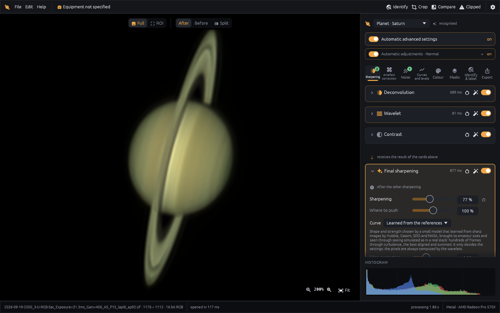
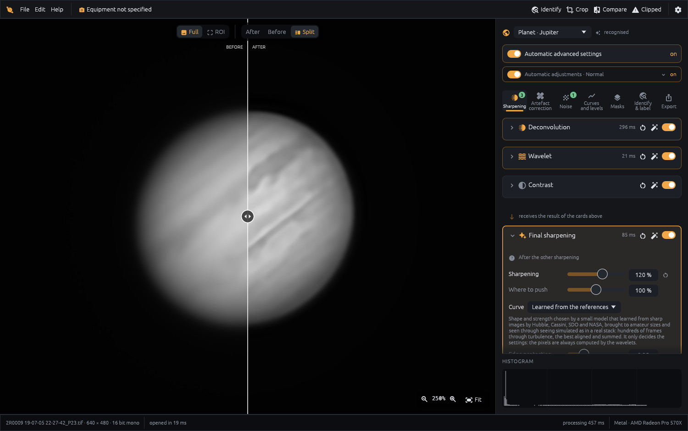
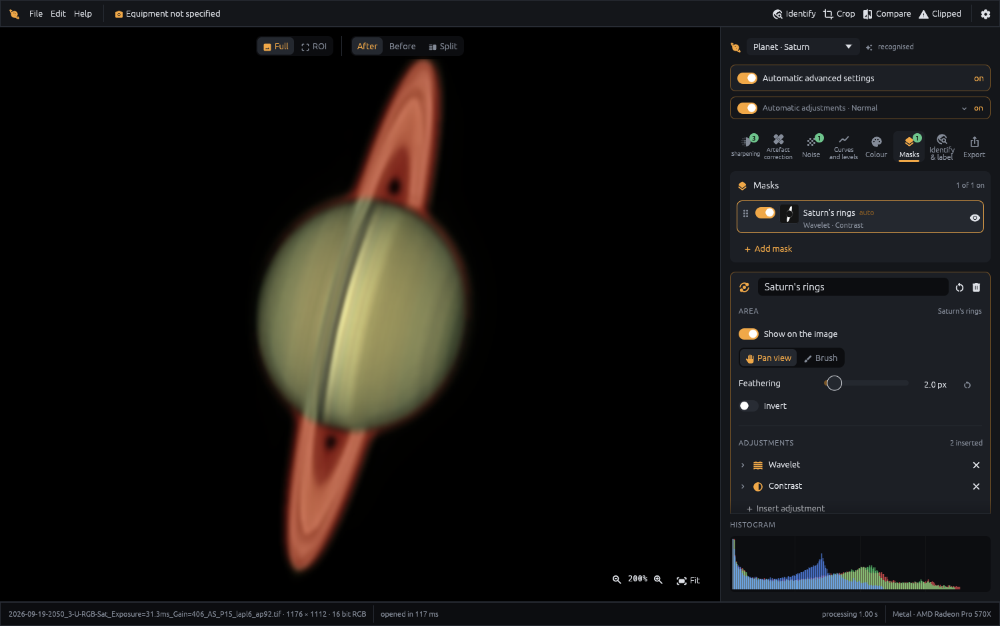
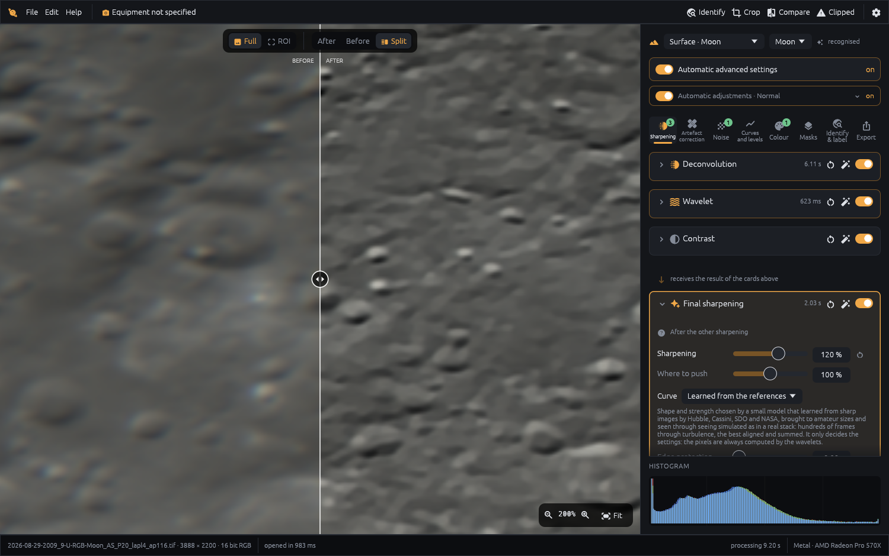
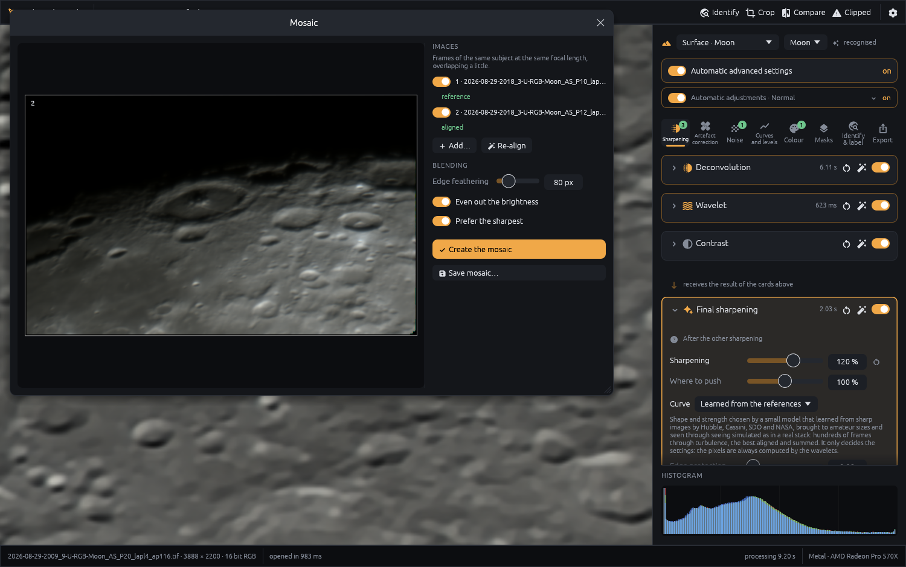
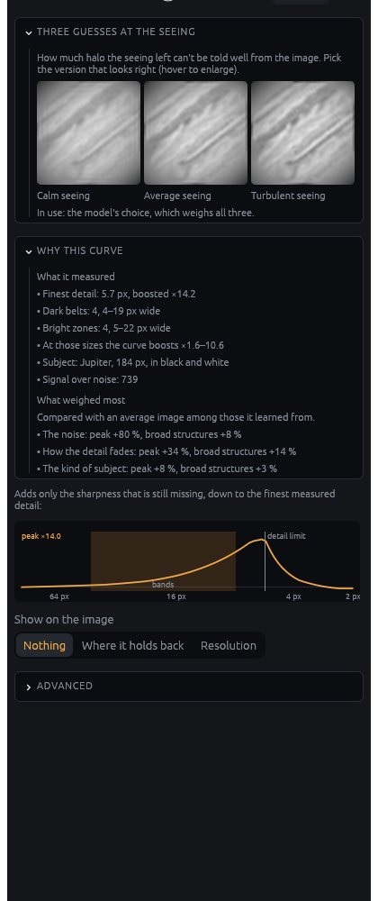

# Planetary Studio — planetary image processing and sharpening for Mac, Windows and Linux

**Fast, non-destructive processing of stacked planetary and lunar images: learned planetary sharpening, wavelets, deconvolution, noise reduction and lunar mosaics — a free alternative to RegiStax and AstroSurface for macOS, Windows and Linux, in English and Italian.**

🇮🇹 [Leggi in italiano](README.it.md)



Planetary Studio picks up where your stacker (AutoStakkert!, RegiStax, …) leaves off: it sharpens, cleans and finishes the stacked TIFF of Jupiter, Saturn, Mars or the Moon — the astrophotography workflow after lucky imaging. It recognises what you opened, proposes sensible settings and explains why — while every slider stays in your hands.

> Lucky imaging and stacking are out of scope: open an image that is already stacked.

## Download

Get the latest version from the **[Releases page](../../releases/latest)**:

| System | File | Notes |
|---|---|---|
| macOS (Intel and Apple Silicon) | `PlanetaryStudio-<version>-universal.dmg` | Open the DMG and drag *Planetary Studio* to *Applications*. |
| Windows 10/11 (64-bit) | `PlanetaryStudio-<version>-windows-x64.exe` | Portable: no installation, just run it. |
| Linux (x86_64) | `PlanetaryStudio-<version>-linux-x86_64.AppImage` | `chmod +x` it and run it. A `.tar.gz` with the bare binary is there too. Needs a Vulkan-capable graphics driver (Mesa is fine). |

**First launch.** The app is not signed with a paid Apple/Microsoft certificate, so the system warns you the first time:

- **macOS** — right-click the app → *Open* → *Open*. On recent macOS versions: *System Settings → Privacy & Security → Open Anyway*.
- **Windows** — on the SmartScreen dialog click *More info* → *Run anyway*.

## Features

- **Automatic recognition** of the subject (planet, Saturn, full disk, lunar surface) with structural settings and explanations of every automatic choice.
- **Deconvolution** — Richardson–Lucy (accelerated, with TV regularisation and damping) and Wiener; PSF measured from the image, drawn on a box, or picked from a star; built-in anti-ringing.
- **Wavelets** — isotropic starlet (*à trous*) with free scales placed from the image spectrum, or classic 1-2-4-8 scales; noise-adaptive gains and edge protection.
- **Learned final sharpening** — a small model picks how much to boost each size of detail, from the belts of Jupiter down to the finest detail the seeing left; the pixels are always computed by classic wavelets, nothing is invented. It was trained on sharp Hubble, Cassini, SDO and NASA images seen through simulated lucky-imaging seeing (hundreds of turbulent frames, the best aligned and stacked). When the image can't tell how turbulent the night was, it shows the result under calm, average and turbulent seeing side by side, and it explains its choice: the belts and zones it measured, where the detail ends, what weighed most.
- **Noise reduction** tuned per subject, **dering** with a brush: paint over the dark ring (inside the limb, in the sky around it, beside a crater) and it is measured and lifted to its surroundings, edges and belts untouched, **curves and levels** (per channel), **colour**, RGB alignment, Mineral Moon.
- **Masks** — process Saturn's rings, its globe, the moons or a painted zone with their own settings. A clear list shows each mask's thumbnail, what it changes and its order (drag to reorder).
- **A/B compare**, split before/after view, ROI preview.
- **Equipment & diagnostics** — telescope/camera catalogue, FireCapture/SharpCap/AutoStakkert! log reading, image scale from ephemerides, spectrum graph.
- **Identify & label** — names of the moons of Jupiter and Saturn, lunar craters and maria, solar orientation, from the capture time; export with the names on the image.
- **Colour** — Jupiter's colour matched to NASA maps belt by belt (photometric colour), solar false-colour palettes for H-alpha.
- **Resize on export** with classic kernels (Lanczos, Mitchell) chosen per subject.
- **Interface in English and Italian** (switch in Settings).
- **Mosaics** of lunar panels taken with the same focal length.
- **Formats**: TIFF 8/16/32-bit, FITS, PNG, JPEG.
- **GPU acceleration** (Metal, DirectX 12, Vulkan through wgpu) with automatic CPU fallback.
- Optional bridge to **BlurXTerminator** if you own a licence of its command-line version.

## Gallery

All pictures are the author's own captures, processed in the app.

| | |
|---|---|
|  |  |
| **Jupiter** — before/after split view | **Saturn** — rings with their own mask |
|  |  |
| **Moon** — crater detail, before/after | **Lunar mosaic** — panels aligned and blended |

### Learned sharpening, explained



The final sharpening card with the learned curve on Jupiter:

- **Three guesses at the seeing** — the subject under calm, average and turbulent seeing; click the one that looks right.
- **Why this curve** — what was measured (finest detail, dark belts and bright zones with their widths, subject, signal over noise) and which of them pushed the curve up or down.
- **The response graph** — how much each size of detail is boosted, with the band of the planet's belts shaded.

The model only chooses settings; the sharpening itself is mathematical and reproducible.

<br clear="right">

## Building from source

You need [Rust](https://rustup.rs) (stable).

```bash
cargo run --release -p ps-app
```

Packages:

```bash
packaging/make_dmg.sh --universal   # macOS DMG, Intel + Apple Silicon
packaging/make_windows.sh           # Windows .exe, cross-compiled from macOS (needs mingw-w64)
packaging/make_linux.sh             # Linux AppImage + tar.gz (run on Linux; GitHub Actions does it for releases)
```

The technical design (algorithms, pipeline, roadmap, bibliography) is in [docs/ARCHITETTURA.md](docs/ARCHITETTURA.md) (Italian).

## License

Copyright © 2026 Weryc. Planetary Studio is **source-available**, released under the **[PolyForm Noncommercial License 1.0.0](LICENSE.md)**.

In short (the license text is what counts):

- ✅ You may use it **for free for any noncommercial purpose** — hobby, study, research, schools, clubs, non-profits.
- ✅ You may read the code and change it for noncommercial purposes, and share it noncommercially as long as you keep the license and the `Required Notice` line.
- ❌ You may **not sell it** or use it for any commercial purpose.
- © Copyright and intellectual property remain with the author.

For commercial use, or any use the license does not cover, please [open an issue](../../issues) to ask for permission.

Third-party libraries keep their own licenses: see [THIRD_PARTY.md](THIRD_PARTY.md).
